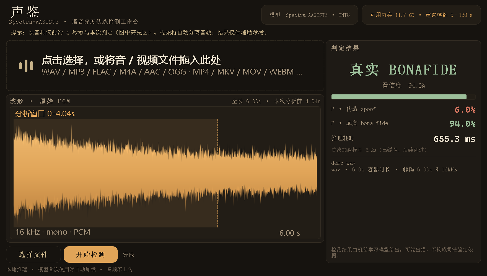

# 声鉴 · 语音深度伪造检测工作台

基于 **Spectra-AASIST3**（INT8 量化 · ONNX Runtime CPU 推理）的本地离线语音深伪检测桌面应用。拖入音频或视频即可判定真伪，无需联网、无需安装 Python 环境（使用打包版时）。



## 功能特性

- **真伪判定**：输出 真实 BONAFIDE / 伪造 SPOOF 结论，附置信度与两类概率、单次推理耗时
- **多格式支持**：音频 wav/mp3/flac/m4a/aac/ogg/opus 等；视频 mp4/mkv/mov/avi 等，自动用 ffmpeg 分离音轨
- **波形视口 + 截取窗口**：视口滚动显示长波形；约 4 s 定长截取窗口（虚线边界）悬停变抓手、拖动选择送检片段、拖至边缘视口自动滚动、松手自动重检
- **暖调鉴定室 UI**：深琥珀主题，字号统一 2 倍缩放（`FONT_SCALE`），窗口自适应分栏
- **判定阈值校准**：默认 0.5 工作点准确率仅 86%，经两份数据集扫描改为 0.9999999658，准确率提升至 99%+

## 项目结构

```
.
├── app.py               # 主程序：UI + ffmpeg 解码 + ONNX 推理
├── selfcheck.py         # offscreen UI 自检
├── requirements.txt     # 依赖包列表
├── bin/                 # ffmpeg.exe / ffprobe.exe（自行放置，gitignore）
└── models/
    └── spectra-aasist3-int8-audio-deepfake/
        └── spectra-aasist3-int8-dynamic.onnx   # 347 MB（自行下载，gitignore）
```

## 模型契约

| 项目 | 值 |
|---|---|
| 输入 | `wav` float32 `[batch, 64600]` @ 16 kHz 单声道 |
| 输出 | `logits` `[batch, 2]` |
| 标签 | 0 = spoof 伪造，1 = bonafide 真实 |
| 预处理 | 预加重 0.97；长音频取截取窗口内 64600 样本，短音频循环平铺至满长 |
| 推理 | ONNX Runtime CPU EP，INT8 动态量化模型，首测加载约 5 s 后缓存 |

## 模型来源与下载

模型：`Limitless-8/spectra-aasist3-int8-audio-deepfake`（HuggingFace，Apache-2.0，基于 `lab260/Spectra-AASIST3` 动态 INT8 量化，无重训练）。

下载 `spectra-aasist3-int8-dynamic.onnx`（约 347 MB）后放入：

```
models/spectra-aasist3-int8-audio-deepfake/spectra-aasist3-int8-dynamic.onnx
```

- 模型页：https://huggingface.co/Limitless-8/spectra-aasist3-int8-audio-deepfake
- 直链：https://huggingface.co/Limitless-8/spectra-aasist3-int8-audio-deepfake/resolve/main/spectra-aasist3-int8-dynamic.onnx
- 基础模型：https://huggingface.co/lab260/Spectra-AASIST3

## ffmpeg 自行放置

本程序依赖 `ffmpeg` / `ffprobe` 提取音轨（视频文件必需，部分音频格式也需要）。二者不随仓库分发，请自行下载 Windows 构建并放入：

```
bin/ffmpeg.exe
bin/ffprobe.exe
```

- 官方构建：https://www.gyan.dev/ffmpeg/builds/ （ffmpeg-release-essentials.zip）
- 也可使用 BtbN 构建：https://github.com/BtbN/FFmpeg-Builds/releases （ffmpeg-master-latest-win64-gpl.zip）

若 `bin/` 下不存在，程序会回退到系统 PATH 中的 `ffmpeg` / `ffprobe`。

## 快速开始

```powershell
pip install -r requirements.txt
# 按上文放置模型与 ffmpeg 后：
python app.py          # 启动界面
python selfcheck.py    # offscreen UI 自检
```

## 评估结果

以下指标由离线批量评估得到（评估脚本不随仓库分发）：

### 实测结果

| 数据集 | 样本 | EER | AUC | Accuracy @UI阈值 |
|---|---|---|---|---|
| 本地标注集 | 1999 | 1.00% | 0.9985 | **99.15%**（FP=2 FN=15） |
| ASVspoof2019 子集 | 8000 | 0.75% | 0.9965 | 99.05%；hc/hh/zh 三类变声 **100% 检出** |

### 阈值校准说明

模型 softmax 输出高度饱和（真实样本概率集中在 1−1e−8 量级），默认阈值 0.5 恰处于饱和区中间，区分度差。对两份数据集联合扫描后，`app.py` 中判定阈值定为 `THRESHOLD_BONA = 0.9999999658`：

| 阈值 | 本地集 Acc | ASVspoof 子集 Acc |
|---|---|---|
| 0.5（默认） | 86.14% | 99.40% |
| 0.8988（ASV 最优点） | 89.04% | 99.50% |
| **0.9999999658（采用）** | **99.15%** | **99.05%** |

## 使用提示

- 每次判定仅取截取窗口内约 4 秒内容，长音频拖动窗口分段复检
- 首次检测加载模型需数秒，之后走缓存
- 结果仅供辅助参考，不作为唯一证据

## 许可与致谢

- 检测模型：`Limitless-8/spectra-aasist3-int8-audio-deepfake`（Apache-2.0），基于 `lab260/Spectra-AASIST3` 与 Meta `wav2vec2-xls-r-300m`
- 评估参考 ASVspoof 2019 LA 数据集子集
